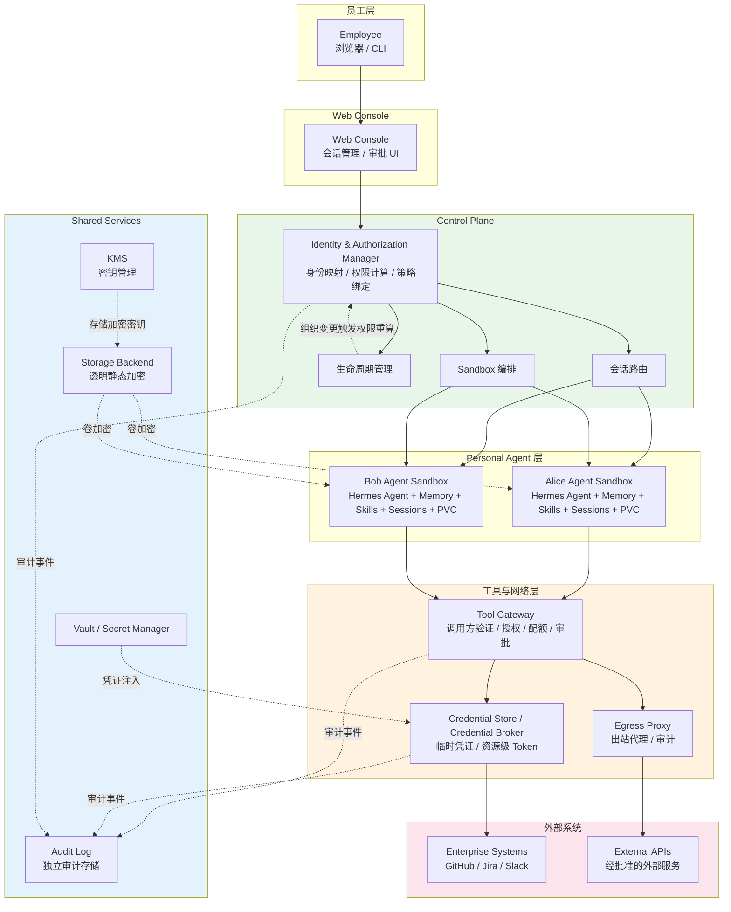

# 第 3 章：总体架构设计

## 本章目标

本章建立企业级 Hermes Agent 平台的总体参考架构，明确各组件的职责、信任边界和关键数据流。通过本章，读者将理解：

- 为什么多租户 Agent 平台需要清晰的分层架构
- 各组件（Web Console、Control Plane、Agent Sandbox、Tool Gateway、Egress Proxy）各自负责什么
- 一次员工请求从登录到 Agent 调用企业 API 的完整链路
- 架构中的信任边界在哪里，哪些安全决策必须在服务端执行

本章是后续所有章节的基础——身份认证（第 4 章）、Sandbox 构建（第 5 章）、网络策略（第 6 章）、Tool Gateway（第 7 章）等都基于这里的架构展开。

## 问题背景与使用场景

企业在引入 AI Agent 时面临的核心矛盾是：**员工需要 Agent 有足够的权限和能力来完成工作，但企业不能把员工的完整权限直接赋予 Agent**。

具体来说：

1. **权限继承问题**：员工 A 和员工 B 可能同属一个部门，但各自负责的系统和数据不同。如果 Agent 直接继承员工的权限，一旦 Agent 被误导或遭攻击，影响范围将不可控。

2. **隔离需求**：每位员工的 Agent 有自己的 Memory、Skills、会话历史和工具调用记录。这些资源既需要被 Agent 访问，又不能被其他员工或 Agent 读取。

3. **工具访问治理**：Agent 需要调用 GitHub、Jira、Slack 等企业内部系统。这些调用必须有身份验证、授权判定、配额控制和审计记录，而不是简单地把 API Token 注入 Agent 环境。

4. **网络出站控制**：Agent 可能访问外部 API、下载文档或执行网络搜索。哪些目标可以访问、经过什么路径、是否需要审计，都需要在架构层面定义。

这些问题不是某个单一组件能解决的，而是需要一组相互配合的组件，各自承担明确的职责，并通过清晰的信任边界连接起来。

## 架构分层

企业级 Hermes Agent 平台采用以下逻辑分层：

```
Employee (Browser / CLI)
    |
    v
+-------------------+
|   Web Console     |  员工界面入口、会话管理、审批 UI
+-------------------+
    |
    v
+-----------------------------------------------------------+
|   Control Plane                                           |
|   +-----------------------------------------------------+ |
|   | Identity & Authorization Manager                    | |
|   |  - Employee → Agent 身份映射                         | |
|   |  - 权限计算与策略绑定                                | |
|   |  - 组织关系变更触发权限重新计算                       | |
|   +-----------------------------------------------------+ |
|   Sandbox 编排  |  生命周期管理  |  会话路由                 |
+-----------------------------------------------------------+
    |
    |  每位员工绑定一个长期存在的 Personal Hermes Agent
    +-----------------------------------------------------------------+
    |                                                                 |
    v                                                                 v
+-----------------------------------+                     +-----------------------------------+
| Alice Personal Hermes Agent       |                     | Bob Personal Hermes Agent         |
|  Agent Identity: agent/alice-001   |                     |  Agent Identity: agent/bob-001     |
|  + Memory / Skills / Sessions     |                     |  + Memory / Skills / Sessions      |
|  + Workspace (加密 PVC)            |                     |  + Workspace (加密 PVC)             |
|  + 多 Session 并发                 |                     |  + 多 Session 并发                  |
+-----------------------------------+                     +-----------------------------------+
    |                                                                 |
    +--------------------------------+--------------------------------+
                                     |
                                     v
                   +-----------------------------------+
                   |   Tool Gateway                    |
                   |   调用方验证、员工-租户绑定、       |
                   |   资源级授权、配额、审批判定         |
                   +-----------------------------------+
                                     |
                    +----------------+----------------+
                    |                                 |
                    v                                 v
     +----------------------------+      +----------------------------+
     | Credential Store /         |      | Egress Proxy               |
     | Credential Broker          |      | 出站流量代理与审计           |
     | 临时凭证、资源级 Token      |      | (配合 NetworkPolicy)        |
     +----------------------------+      +----------------------------+
             |                                 |
             v                                 v
     +----------------------------+      +----------------------------+
     | Enterprise Systems         |      | External APIs / Internet   |
     | GitHub / Jira / Slack / ...|      | (经批准的域名)              |
     +----------------------------+      +----------------------------+

    [Shared Services]
    +------------------+  +------------------+  +------------------+  +------------------+
    |   KMS            |  |   Vault /        |  |   Storage        |  |   Audit Log      |
    |   密钥管理        |  |   Secret Manager |  |   后端(EBS/Ceph) |  |   独立审计存储    |
    |   透明加密密钥    |  |   工具调用凭证    |  |   静态加密       |  |   接收多方事件    |
    +------------------+  +------------------+  +------------------+  +------------------+
          ^                      ^                      ^                     ^
          |                      |                      |                     |
          +-- 存储加密密钥 --+    +-- 凭证注入 --+        +-- 卷加密 --+        +-- Tool Gateway /
                                                                          Control Plane /
                                                                          Credential Store
```

**完整组件交互流程图（Mermaid）**：



### 3.1 Web Console

**职责**：员工与平台交互的界面入口。

- 提供 OIDC 登录（通过企业 IdP，如 Okta、Azure AD、Google Workspace；本地开发使用 Dex）
- 展示 Agent 会话界面，显示模型的回复、工具调用和结果
- 提供审批工作流界面（当高风险操作需要人工审批时）
- 将用户的认证状态传递给 Control Plane

**不负责**：

- 不存储企业系统的 API Token
- 不直接调用企业工具
- 不做授权决策（授权由服务端 Control Plane 和 Tool Gateway 执行）

Web Console 的技术选型通常是 Next.js / React 应用，部署在 Kubernetes 中或通过 CDN 托管。它通过 HTTPS 与 Control Plane 的后端 API 通信。

### 3.2 Control Plane

**职责**：平台的编排中枢。

- **身份映射**：将企业 IdP 返回的员工身份映射到平台内部的用户 ID，并关联到租户（Tenant）。
- **策略配置**：管理租户级别的策略，例如哪些工具可用、配额限制、审批规则。
- **Sandbox 编排**：当员工首次登录或被管理员激活时，Control Plane 负责为该员工创建独立的 Agent Sandbox（Kubernetes 资源，见第 5 章）。
- **生命周期管理**：处理员工的入职、离职、权限变更，包括 Sandbox 的创建、暂停、销毁。
- **会话路由**：当员工在 Web Console 发起 Agent 对话时，Control Plane 将请求路由到对应的 Agent Sandbox。

**不负责**：

- 不直接持有企业系统的凭证（由 Vault 或 Secret Manager 管理，见第 8 章）
- 不执行工具调用级别的授权决策（由 Tool Gateway 执行）
- 不处理网络层面的出站控制（由 Egress Proxy / NetworkPolicy 执行）

Control Plane 通常实现为 TypeScript / Node.js 服务，使用 PostgreSQL 存储元数据（用户、租户、策略、会话记录）。

### 3.3 Per-employee Agent Sandbox

**职责**：每位员工运行一个独立的 Hermes Agent 实例。

每个 Sandbox 包含：

- **Hermes Agent 进程**：执行 Agent Loop（接收用户输入 → 调用模型 → 解析工具调用 → 执行工具 → 返回结果 → 继续循环）
- **独立工作目录**：Agent 的文件操作空间，其他 Sandbox 不可访问
- **Memory 存储**：该员工 Agent 的长期记忆，经过提炼的事实和技能
- **Skills**：该员工启用的工具定义和提示词模块
- **会话历史**：当前和历史的 Agent 对话

Sandbox 的技术实现（第 5 章详细展开）：

| 资源 | 说明 |
|------|------|
| Kubernetes Namespace | 员工级隔离边界（One Person, One Namespace） |
| Kubernetes Pod | 运行 Hermes Agent 进程（单实例） |
| ServiceAccount | 最小权限的工作负载身份（见 4.2 节） |
| PersistentVolumeClaim (加密) | 持久化工作目录、Memory 和会话，静态加密 |
| 资源限制 | CPU、内存、存储配额 |

**关键设计决策**：为什么每位员工一个 Sandbox，而不是多租户共享？

1. **Memory 隔离**：每位员工的长期记忆是个性化的，包含其工作内容、偏好和历史。共享实例会导致 Memory 交叉污染。
2. **故障隔离**：一个 Agent 的异常（如陷入无限循环、内存泄漏）不影响其他员工。
3. **安全隔离**：配合 Kubernetes 网络策略和容器安全配置，每个 Sandbox 是独立的信任域。
4. **审计粒度**：每个 Sandbox 的日志和指标天然绑定到单个员工，便于审计和排查。

**Sandbox 不直接访问企业系统**。所有工具调用必须通过 Tool Gateway。

#### 一人一 Agent：逻辑绑定与身份稳定性

架构中存在一个核心的逻辑关系：**每位员工绑定一个长期存在的 Personal Agent Identity**。这个绑定由 Control Plane 的 Identity & Authorization Manager 维护，具有以下特征：

- **一对一绑定**：一名员工对应一个 Agent Identity，不会因任务不同而切换 Agent。Agent 通过选择合适的 Skills 和工具来处理不同类型的任务。
- **身份稳定**：Agent Identity 是稳定的、长期的标识符（如 `agent/alice-001`），不因 Pod 重启、重建或镜像升级而改变。Pod 只是 Agent 的运行时实例（Runtime Instance），销毁后新建的 Pod 仍加载同一个 Agent Identity。
- **状态积累**：Agent 随时间积累 Memory、Skills、Sessions 和 Workspace 数据。这些状态持久化在加密 PVC 中，与 Agent Identity 绑定，而非与某个具体的 Pod 绑定。
- **多 Session 并发**：同一员工的 Agent 可以同时承载多个对话 Session（如同时处理代码审查和文档编写）。这些 Session 共享同一个 Agent Identity、Memory 和工具权限，但需要适当的并发控制以避免资源冲突和状态不一致。

在概念上需要区分四个层次：

| 层次 | 说明 | 生命周期 |
|------|------|----------|
| Employee Identity | 员工在企业 IdP 中的身份 `(issuer, subject)` | 员工在职期间 |
| Agent Identity | 平台分配的长期 Agent 标识（如 `agent/alice-001`） | 员工在职 + 离职保留期 |
| Runtime Instance | 承载 Agent 的 Kubernetes Pod | 分钟到数天（可重建） |
| Persistent State | Memory、Skills、Sessions、Workspace | 与 Agent Identity 同生命周期 |

这种设计确保了：员工的 Agent 不会因为一次 Pod 重建而丢失 Memory；组织关系变更时，Control Plane 只需更新 Agent Identity 对应的权限策略，而不需要重新创建整个运行环境。

### 3.4 Tool Gateway

**职责**：统一承接 Agent 的企业工具调用，实施调用方验证、授权、配额和审计。

当 Agent 需要调用 GitHub API 时，它不会直接把 Token 发到 GitHub，而是向 Tool Gateway 发起请求。Tool Gateway 执行以下检查：

1. **调用方验证**：确认请求来自哪个 Agent Sandbox（通过 mTLS、Workload Identity 或内部 Token）。
2. **员工与租户绑定**：确认该 Sandbox 属于哪位员工、哪个租户。
3. **资源级授权**：确认该员工是否有权限执行此操作（例如，是否有权限向某个 GitHub Repository 提交 PR）。
4. **配额检查**：确认未超过 API 调用频率或每日配额。
5. **审批判定**：如果操作属于高风险（如删除生产环境资源），触发审批流程。
6. **执行与审计**：通过检查后，Tool Gateway 使用受管凭证执行实际操作，并记录审计日志。

```
Agent Sandbox                    Tool Gateway                     Enterprise System
     |                                |                                |
     |-- 调用 GitHub API (PR 创建) -->|                                |
     |                                |-- 验证调用方身份              |
     |                                |-- 检查员工权限                 |
     |                                |-- 检查配额                     |
     |                                |-- 检查是否需要审批             |
     |                                |                                |
     |                                |-- 使用受管凭证创建 PR -------->|
     |                                |<-- 操作结果 --------------------|
     |<-- 返回结果 --------------------|                                |
     |                                |-- 记录审计日志                 |
```

Tool Gateway 的实现基于 MCP（Model Context Protocol）Server，但 MCP 只是工具连接协议，不是授权边界。授权必须由 Tool Gateway 在服务端执行（见第 7 章）。

#### 外部服务授权委托

Tool Gateway 不直接持有企业系统的长期凭证。当授权检查通过后，Tool Gateway 向 **Credential Store / Credential Broker** 请求临时凭证或资源级 Token，由 Credential Broker 代表 Tool Gateway 访问外部系统。这种设计实现了授权与凭证持有的分离：

- **Credential Broker**：根据 Tool Gateway 传入的 Agent Identity、员工身份、目标资源和操作类型，生成或获取最小权限的临时凭证（如 GitHub 的 Fine-grained PAT、短期 OAuth Token）。
- **权限回收**：临时凭证具有明确的过期时间，操作完成后即失效。员工权限变更时，Control Plane 通知 Credential Broker 撤销相关凭证，无需等待过期。
- **审计链路**：Credential Broker 记录每次凭证发放和使用的审计事件，与 Tool Gateway 的授权日志关联，形成完整的访问链路。

这意味着：即使 Tool Gateway 被攻破，攻击者也无法直接获取企业系统的长期凭证；即使某个临时凭证泄露，其权限范围和时间窗口也受到严格限制。

### 3.5 Egress Proxy / Network Policy

**职责**：控制 Agent 的网络出站路径。

这是两个互补的层面：

**Egress Proxy（正向代理）**：

- 拦截 Agent 的 HTTP/HTTPS 出站流量
- 对允许的域名进行转发（如企业 API、批准的公共 API）
- 记录访问日志（域名、时间、字节数；HTTPS 正文是否可见取决于 TLS 检查配置）
- 可选：内容过滤和恶意域名拦截

**NetworkPolicy（网络层强制）**：

- 在 Kubernetes 层面限制 Pod 可以连接的目标 IP 和端口
- 即使 Agent 绕过了代理配置（如直接设置目标 IP），网络策略仍然阻止连接
- 仅允许访问 Tool Gateway、Egress Proxy 和必要的内部服务

```
Agent Sandbox
    |
    +-- [NetworkPolicy: 仅允许访问以下目标] --+
    |                                        |
    v                                        v
Tool Gateway (内部)                  Egress Proxy (出站)
    |                                        |
    v                                        v
Enterprise Systems                  外部 API / 互联网
```

**重要说明**：

- `HTTP_PROXY` / `HTTPS_PROXY` 环境变量只是应用配置，不能单独作为安全边界。Agent 进程可以忽略它们。
- 必须通过 Kubernetes NetworkPolicy 或 CiliumNetworkPolicy 在网络层强制执行（第 6 章详细展开）。
- 出站代理只能审计它实际能够观察到的流量。如果使用 TLS CONNECT 隧道且没有 TLS 检查，不能声称可以检查 HTTPS 正文。

### 3.6 Shared Services

以下服务为所有 Sandbox 共享，但按租户或员工进行逻辑隔离：

| 服务 | 说明 |
|------|------|
| 模型服务 | 提供 LLM API 访问（可能是云端模型或本地部署） |
| 知识检索 | RAG 服务，按员工权限过滤检索结果 |
| 凭证管理 | Vault 或云 Secret Manager，管理工具调用凭证（第 8 章） |
| KMS | 密钥管理服务，为存储加密提供密钥（第 8 章） |
| 存储后端 | 提供 PVC 的块存储/文件系统，并启用透明静态加密（第 5 章） |
| 元数据存储 | PostgreSQL，存储用户、租户、策略、会话元数据 |
| 可观测性 | OpenTelemetry 收集 Trace、Metric、Log（第 10 章） |

共享服务必须实施租户隔离：知识检索结果必须按员工的实际权限过滤，不能返回其无权访问的文档。

**存储与 KMS 在架构中的职责**：

- **KMS**：管理存储加密密钥的生命周期（创建、轮换、禁用、销毁），控制谁可以使用密钥进行加密/解密操作。KMS 不直接处理每次文件读写——读写由存储后端透明完成。
- **存储后端**：在数据写入磁盘时自动加密，读取时自动解密。Hermes Agent 使用标准文件接口读写数据，不感知加解密过程。
- **KMS ≠ 存储后端**：KMS 提供密钥管理能力，存储后端使用 KMS 密钥完成透明加解密。两者配合，但职责不同。

## 关键数据流

### 3.7 员工首次登录到 Agent 可用

```
1. 员工浏览器 → IdP（OIDC 登录）
   - 正式环境：企业 IdP（Google Workspace、Okta、Azure AD 等）
   - 本地开发/测试：Dex（开源 OIDC Provider，预置静态测试用户）
2. IdP → 浏览器（授权码）
3. 浏览器 → Control Plane（授权码 + PKCE verifier）
4. Control Plane → IdP（换取 Access Token / ID Token）
5. IdP → Control Plane（Token，包含员工身份）
6. Control Plane：
   a. 验证 Token（签名、Issuer、Audience、Nonce、有效期）
   b. 查找或创建用户记录
   c. 关联到租户
   d. 如果首次登录：创建 Agent Sandbox
      - Kubernetes Pod
      - PersistentVolumeClaim
      - ServiceAccount（最小权限）
      - NetworkPolicy
   e. 生成平台 Session（安全 Cookie）
7. Control Plane → 浏览器（Session Cookie，重定向到 Console）
8. 员工在 Console 中看到 Agent 界面
```

这个流程中，关键的安全决策：

- OIDC 必须在服务端完整验证（第 4 章）
- Sandbox 创建由 Control Plane 执行，不是 IdP 或 Web Console
- 员工身份到 Agent Sandbox 的映射在服务端维护

### 3.8 员工发起一次 Agent 对话

```
1. 员工在 Web Console 输入问题
2. Web Console → Control Plane API（带 Session Cookie）
3. Control Plane：
   a. 验证 Session
   b. 查找该员工对应的 Agent Sandbox
4. Control Plane → Agent Sandbox（转发用户输入）
5. Agent Sandbox（Hermes Agent）：
   a. 构建 Prompt（System Prompt + 用户输入 + 上下文）
   b. 调用模型服务
   c. 解析响应，如果有工具调用：
      i. Agent → Tool Gateway（工具调用请求）
      ii. Tool Gateway 执行授权检查（调用方、员工、权限、配额）
      iii. 通过 → 执行实际操作，返回结果
      iv. 未通过 → 返回错误或触发审批
   d. 如果有工具结果，继续调用模型或返回最终回复
6. Agent Sandbox → Control Plane（Agent 回复 + 工具调用记录）
7. Control Plane → Web Console（展示给员工）
8. Control Plane → 审计服务（记录完整链路）
```

### 3.9 高风险操作审批流程

```
1. Agent 尝试执行高风险操作（如删除生产数据库表）
2. Tool Gateway 识别操作风险等级
3. Tool Gateway → Control Plane（创建审批请求，绑定具体操作、目标和参数）
4. Control Plane → Web Console（通知审批人）
5. 审批人在 Console 中审查操作详情
6. 审批人 → Control Plane（批准 / 拒绝）
7. Control Plane → Tool Gateway（审批结果）
8. Tool Gateway：
   - 批准 → 使用受管凭证执行操作，记录审计日志
   - 拒绝 → 返回错误给 Agent，Agent 告知员工
```

审批必须绑定具体操作、目标和参数，防止"批准了一个操作，实际执行了另一个"。

## 身份与授权生命周期

平台中员工与 Agent 的关系不是一次性建立的，而是贯穿员工入职、调岗、离职的完整生命周期。Control Plane 的 Identity & Authorization Manager 负责在组织关系变化时触发权限的重新计算和应用。

### 员工入职：Agent 创建与初始授权

当新员工加入企业时：

```
1. HR 系统 / 管理员在 IdP 中创建员工身份
2. 员工首次通过 OIDC 登录 Web Console
3. Control Plane 验证 OIDC Token，识别为新用户
4. Identity & Authorization Manager：
   a. 创建平台内部用户记录，绑定 (issuer, subject)
   b. 关联到租户，根据部门/角色加载初始策略
   c. 分配 Agent Identity（如 agent/alice-001）
5. Sandbox 编排器为该 Agent 创建运行环境：
   - 独立 Namespace、Pod、加密 PVC
   - 最小权限 ServiceAccount
   - 网络策略（仅允许访问 Tool Gateway 和 Egress Proxy）
6. Credential Broker 为该 Agent 初始化可用工具的凭证模板（非实际 Token，而是权限范围定义）
7. 员工在 Console 中看到 Agent 界面，可以开始对话
```

此时 Agent 处于"初始状态"——Memory 为空、仅启用基础 Skills、工具权限按角色默认策略设定。随着员工使用，Agent 逐步积累 Memory 和定制 Skills。

### 员工调岗：权限重新计算

当员工从一个部门调到另一个部门（或角色发生变化）时：

```
1. HR 系统 / 管理员更新员工的部门或角色信息
2. 变更事件 → Control Plane（通过 Webhook 或定时同步）
3. Identity & Authorization Manager：
   a. 检测组织关系变更
   b. 重新计算该员工 Agent Identity 对应的权限策略
   c. 撤销旧角色下的工具权限（如原部门的 GitHub Repository 访问权）
   d. 授予新角色下的工具权限
4. Credential Broker：
   a. 回收已撤销权限对应的临时凭证
   b. 生成新权限范围内的凭证模板
5. Tool Gateway 收到策略更新，后续工具调用按新策略执行
6. 审计日志记录：权限变更事件、撤销的操作、新增的权限
```

**关键点**：权限变更的是 Agent Identity 对应的策略，而不是重建 Sandbox。Agent 的 Memory、Skills 和会话历史保留不变，但能调用的工具和可访问的资源范围已更新。正在进行的对话可能在下次工具调用时收到权限不足的响应，这是预期行为——授权检查在每次工具调用时执行。

### 员工离职：Agent 回收与数据处理

当员工离开企业时：

```
1. HR 系统禁用或删除员工在 IdP 中的身份
2. IdP 不再为该身份发放有效 Token
3. Control Plane 收到离职事件（通过 Webhook 或定时同步）
4. Identity & Authorization Manager：
   a. 标记该员工对应的 Agent Identity 为"已停用"
   b. 撤销所有工具权限
5. Credential Broker 回收该 Agent 的所有临时凭证
6. Sandbox 编排器：
   a. 停止 Agent Pod（不再接受新请求）
   b. 保留加密 PVC（按数据保留策略，如 90 天）
   c. 禁止新的 Session 创建
7. 审计日志记录：停用事件、凭证回收、PVC 保留期限
```

**数据保留策略**：

- PVC 中的 Agent 数据（Memory、Sessions、Workspace）在保留期内保持加密存储，可按合规要求导出或彻底删除。
- 保留期结束后，Control Plane 触发 PVC 删除，并确认底层存储和备份中的对应数据已清除。
- 审计日志中的历史记录按独立的保留策略管理，不因员工离职而删除——审计日志是企业的合规资产。

## 信任边界

架构中的信任边界是安全设计的核心。以下是关键边界：

```
┌───────────────────────────────────────────────────────┐
│  不可信区域                                             │
│                                                       │
│  Employee Browser / Device                            │
│  （浏览器可被操控，设备可能感染恶意软件）                  │
└─────────────────────┬─────────────────────────────────┘
                      │ 边界 1：OIDC 认证 + Session
                      v
┌───────────────────────────────────────────────────────┐
│  半信任区域                                            │
│                                                       │
│  Web Console（前端）                                    │
│  （可被 XSS 攻击，但后端不信任前端传来的敏感决策）         │
└─────────────────────┬─────────────────────────────────┘
                      │ 边界 2：服务端 Session 验证 + 授权
                      v
┌───────────────────────────────────────────────────────┐
│  信任区域（服务端）                                      │
│                                                       │
│  Control Plane                                        │
│  - 验证身份、维护映射                                   │
│  - 不信任 Agent 传来的 employee_id / tenant_id         │
└─────────────────────┬─────────────────────────────────┘
                      │ 边界 3：Sandbox 隔离 + 最小权限
                      v
┌───────────────────────────────────────────────────────┐
│  半信任区域                                            │
│                                                       │
│  Agent Sandbox（Hermes Agent）                          │
│  - 可能被 Prompt Injection 误导                          │
│  - 被限制在最小权限内                                   │
│  - 网络出站受 NetworkPolicy 约束                        │
└─────────────────────┬─────────────────────────────────┘
                      │ 边界 4：Tool Gateway 授权
                      v
┌───────────────────────────────────────────────────────┐
│  信任区域                                              │
│                                                       │
│  Tool Gateway                                         │
│  - 验证调用方身份                                      │
│  - 执行服务端授权                                     │
│  - 持有受管凭证                                       │
└─────────────────────┬─────────────────────────────────┘
                      │ 边界 5：凭证受管访问
                      v
┌───────────────────────────────────────────────────────┐
│  外部系统                                              │
│                                                       │
│  Enterprise Systems（GitHub / Jira / Slack / ...）     │
└───────────────────────────────────────────────────────┘
```

### 边界 1：浏览器 → 服务端

- 浏览器不可信。任何从浏览器传来的数据都必须验证。
- OIDC Token 必须在服务端验证，不能信任浏览器解析的结果。
- Session Cookie 必须设置 `Secure`、`HttpOnly`、`SameSite`。

### 边界 2：Web Console → Control Plane

- Control Plane 不信任前端传来的身份声明。每次 API 调用都通过 Session Cookie 验证。
- 前端可以展示"当前用户是 Alice"，但 Control Plane 通过 Session 独立验证。

### 边界 3：Control Plane → Agent Sandbox

- Control Plane 拥有员工到 Sandbox 的映射。Agent 不能声称"我是 Alice 的 Agent"。
- Agent Sandbox 使用最小权限 ServiceAccount。不默认授予 Kubernetes API 访问权。
- 不同 Sandbox 之间网络隔离，文件系统隔离。

### 边界 4：Agent Sandbox → Tool Gateway

- **这是最关键的边界之一**。Agent 可能被 Prompt Injection 误导，发出有害的工具调用请求。
- Tool Gateway 不信任 Agent 传来的 `employee_id`、`tenant_id`、`action` 等参数。
- Tool Gateway 通过独立的通道（如 mTLS 证书、Kubernetes ServiceAccount Token 或内部 Token）识别调用方来自哪个 Sandbox。
- 授权在服务端执行：这个 Sandbox 对应的员工是否有权限执行此操作？

### 边界 5：Tool Gateway → Enterprise Systems

- 企业系统的凭证由 Vault 或 Secret Manager 管理，不注入 Agent 环境。
- Tool Gateway 使用临时凭证或受管凭证访问企业系统。
- 每次访问都记录审计日志。

### 边界 6：运行时数据 → 静态数据

- Agent Sandbox 运行时通过标准文件系统读写数据（内存和磁盘中均为明文）。
- 数据写入 PVC 时，存储后端透明加密并落盘。静态数据受 KMS 密钥保护。
- 加密保护的是落盘数据（at rest），不阻止有挂载权限的进程读取明文。运行时访问控制依赖 RBAC、Namespace 隔离和最小权限工作负载身份。
- 备份和快照继承了底层卷的加密属性，但需要独立的密钥和访问策略。

## 失败模式

即使架构设计正确，以下情况仍可能导致安全问题：

| 失败模式 | 影响 | 缓解措施 |
|----------|------|----------|
| OIDC Token 未在服务端验证 | 攻击者伪造身份 | 完整验证签名、Issuer、Audience、Nonce、有效期 |
| Agent 传入 `employee_id` 被信任 | 权限提升 | Tool Gateway 独立识别调用方 |
| NetworkPolicy 配置遗漏 | Agent 直连外部系统 | 正向和负向测试验证策略 |
| Tool Gateway 授权逻辑有缺陷 | 未授权操作被执行 | 代码审查、自动化测试、审计日志 |
| Memory 跨租户污染 | 信息泄露 | 严格租户隔离的 Memory 存储 |
| 审批请求内容被替换 | 批准的操作与实际执行不同 | 审批绑定操作哈希，执行前再次验证 |
| PVC 未启用加密 | 落盘数据明文可读 | 使用加密 StorageClass，验证加密状态（第 5 章） |
| KMS key 权限过于宽泛 | 未授权身份可操作密钥 | 最小权限 KMS 策略，限制密钥管理权限（第 8 章） |
| 备份/快照未加密 | 备份介质泄露导致数据暴露 | 备份继承卷加密，独立控制备份访问策略 |

## 本章小结

本章建立了企业级 Hermes Agent 平台的总体架构：

1. **分层设计**：Web Console → Control Plane → Per-employee Agent Sandbox → Tool Gateway → Credential Broker / Egress Proxy → Enterprise Systems。
2. **一人一 Agent**：每位员工绑定一个长期存在的 Personal Agent Identity，身份不因 Pod 重建而改变，随时间积累 Memory、Skills 和 Sessions。
3. **Identity & Authorization Manager**：作为 Control Plane 的子组件，负责员工到 Agent 的身份映射、权限计算、策略绑定，以及在组织关系变更时触发权限重新计算。
4. **Credential Store / Credential Broker**：Tool Gateway 不直接持有长期凭证，而是通过 Credential Broker 获取临时凭证访问外部系统，实现授权与凭证持有的分离。
5. **Audit Log**：独立审计存储接收来自 Tool Gateway、Control Plane 和 Credential Store 的审计事件，形成完整的访问链路。
6. **持久化存储加密**：每位员工的 PVC 默认启用存储后端透明静态加密，由 KMS 管理密钥。
7. **网络出站双保险**：Egress Proxy 做应用层转发和审计，NetworkPolicy 做网络层强制。
8. **信任边界清晰**：每一层都独立验证身份和权限，不信任上游传来的身份声明。
9. **身份与授权生命周期**：员工入职时创建 Agent 并授予初始权限，调岗时重新计算权限并回收旧凭证，离职时停用 Agent 并按保留策略处理数据。

后续章节将基于这个架构展开：

- **第 4 章**：实现 OIDC 身份认证与员工到 Sandbox 的身份映射
- **第 5 章**：在 Kubernetes 中为每位员工构建隔离的 Agent Sandbox，包括加密持久化存储
- **第 6 章**：使用 Cilium 控制 Agent 的网络出站访问
- **第 7 章**：构建 Tool Gateway，实施资源级授权
- **第 8 章**：KMS 密钥管理、凭证访问控制和最小权限设计

## 参考资料

- Kubernetes 多租户隔离：https://kubernetes.io/docs/concepts/security/pod-security-standards/
- OIDC Authorization Code Flow with PKCE：https://openid.net/specs/openid-connect-core-1_0.html
- Dex（本地 OIDC Provider）：https://dexidp.io/
- MCP（Model Context Protocol）：https://modelcontextprotocol.io/
- 参考案例：Razorpay Hermes 部署实践 https://engineering.razorpay.com/running-hermes-at-razorpay-a-network-isolated-self-improving-second-brain-for-every-employee-f91d56bea3f1
