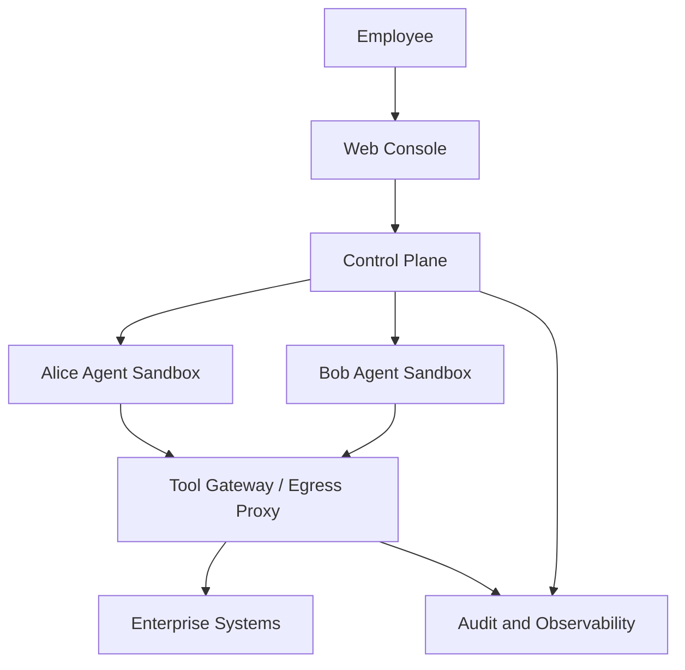

# 第 3 章：总体架构设计

> 状态：待撰写

## 本章目标

建立全书参考架构，明确各组件职责和关键数据流。

## 建议内容

- 多租户 Agent 平台的核心需求
- 控制平面、Agent 运行时、工具网关与数据存储的职责划分
- 每位员工一个独立 Agent Sandbox 的设计
- Kubernetes Pod、Namespace、ServiceAccount 与持久化存储
- 共享服务和个人资源之间的边界
- 一次请求从登录到 Agent 调用企业 API 的完整链路
- 信任边界、威胁面和失败模式

## 初步架构

## 本章产出

- 总体架构图
- 组件职责表
- 关键请求时序图
