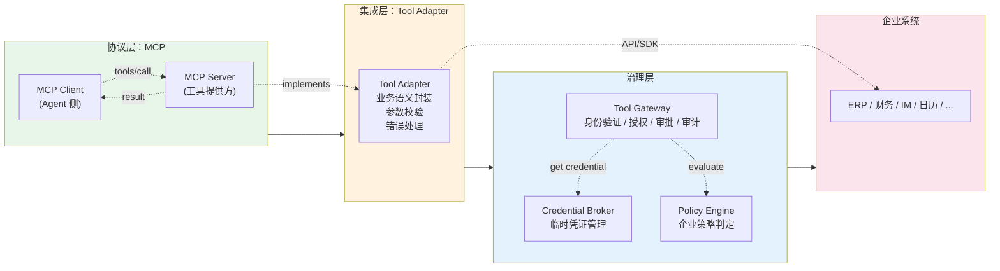
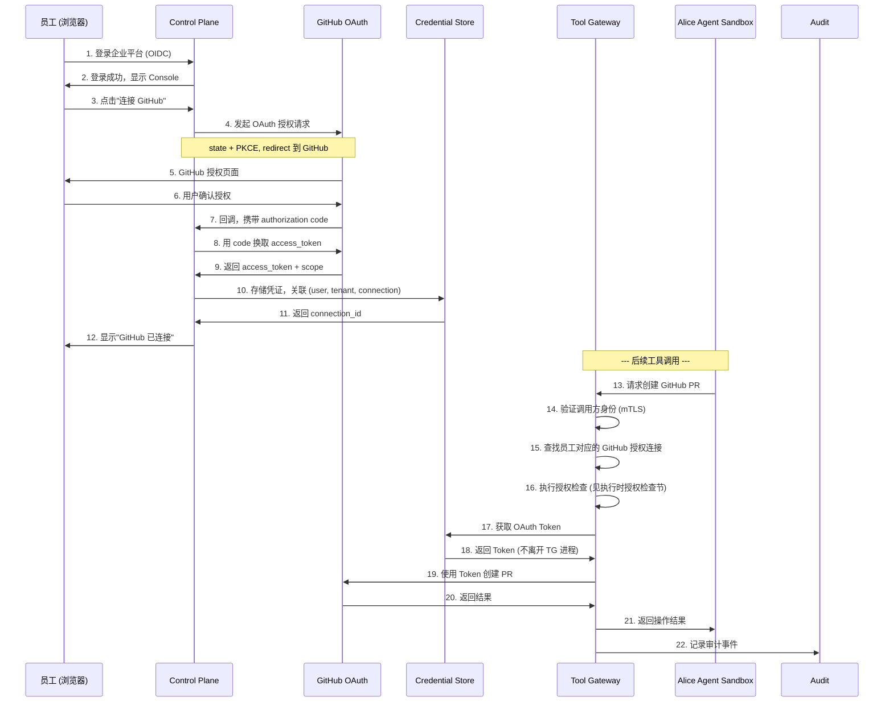
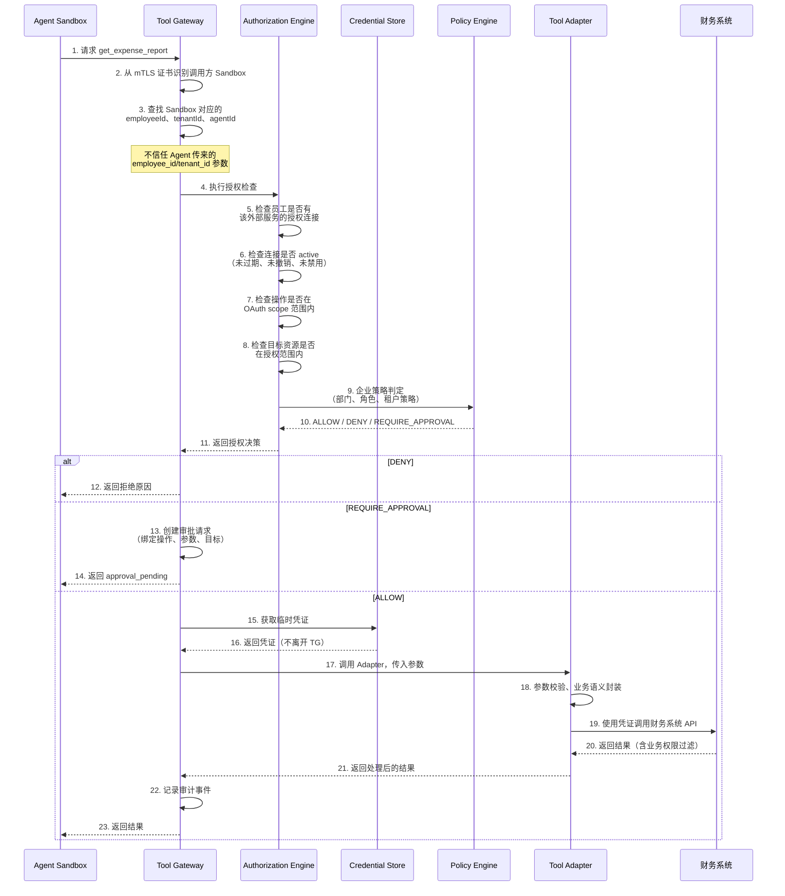
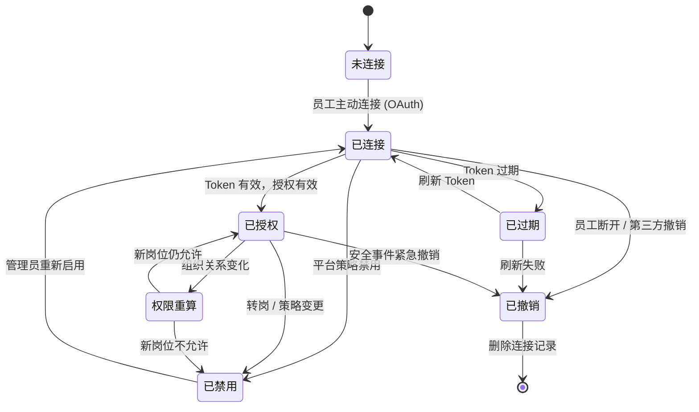

# 第 7 章：构建 Tool Gateway，统一企业 API 访问

## 本章目标

为 Agent 访问企业系统建立统一、可审计且能够实施资源级授权的入口。通过本章，读者将理解：

- 为什么不能直接向 Agent 注入企业 API Token
- Tool Gateway 的职责、架构与信任边界
- MCP 作为工具连接协议的作用——它不是授权边界
- 员工如何委托 Agent 代表自己访问 GitHub 等外部服务
- 委托授权的两种模式：OAuth 代表用户访问 vs 企业应用身份访问
- 执行时授权检查必须考虑的多维度因素
- 授权的生命周期管理：连接、撤销、过期、转岗、离职
- 调用方身份、员工身份与资源权限的绑定

## 问题背景与使用场景

Hermes Agent 需要调用 GitHub 创建 Pull Request、查询 Jira 工单、向 Slack 频道发送消息。如果直接把 API Token 注入每个 Agent 的环境变量：

1. **权限不可控**：Agent 持有 Token 后，可以做 Token 权限范围内的任何事，不受企业策略限制。
2. **无法审计**：Token 直接从 Agent 发出，没有中间层记录谁在什么时间做了什么操作。
3. **凭证泄露风险**：被 Prompt Injection 诱导的 Agent 可能将 Token 发送给外部服务。
4. **轮换困难**：每次轮换 Token 需要更新所有 Agent Sandbox。
5. **权限无法随转岗回收**：员工从研发部调到市场部后，Agent 环境中的 GitHub Token 仍然有效。

**解决方案**：Agent 不直接持有企业凭证，而是通过 Tool Gateway 代理所有企业 API 调用。Tool Gateway 在服务端执行授权检查，使用受管凭证完成实际操作，并记录完整审计日志。

## 威胁模型与设计目标

### 威胁模型

| 威胁 | 来源 | 影响 | 缓解 |
|------|------|------|------|
| Agent 持有企业 API Token | 环境变量、配置文件注入 | 被误导后直接调用企业 API | Agent 不持有凭证，所有调用经 Tool Gateway |
| 未授权 Agent 调用企业 API | NetworkPolicy 配置错误 | 跨 Sandbox 滥用 | mTLS / Workload Identity 验证调用方 |
| Agent 伪造 `employee_id` 提权 | Tool 调用参数篡改 | 权限提升 | Tool Gateway 独立识别调用方身份 |
| OAuth 授权被扩大使用 | Token 权限范围 > 实际需要的范围 | 未授权操作被执行 | 执行时多维授权检查 |
| 转岗后旧权限仍然可用 | 授权未随组织关系变化回收 | 越权访问 | 权限重算 + 第三方授权撤销 |
| Token 被记录到日志 | 调试输出、错误日志 | 凭证泄露 | 日志脱敏，不记录凭证值 |

### 设计目标

1. **Agent 不持有企业 API 凭证**：所有工具调用通过 Tool Gateway 执行。
2. **调用方身份可验证**：通过 mTLS 或 Workload Identity 确认请求来自哪个 Agent Sandbox。
3. **多维授权检查**：每次工具调用都验证员工、租户、Agent、外部授权、目标资源和操作。
4. **委托授权治理**：员工主动委托 Agent 访问外部服务，但委托范围受企业策略约束。
5. **授权生命周期可管理**：连接、撤销、过期、转岗、离职都有明确的处理流程。
6. **审计完整**：记录调用方、员工、操作、资源、策略结果，不记录凭证值。

## 架构与工作机制

### Tool Gateway 在总体架构中的位置

```
┌─────────────────────────────────────────────────────────────┐
│  Control Plane                                              │
│  ┌──────────────┐  ┌──────────────────┐  ┌───────────────┐ │
│  │ Identity     │  │ Authorization    │  │ Lifecycle     │ │
│  │ Mapper       │  │ Manager          │  │ Manager       │ │
│  └──────────────┘  └──────────────────┘  └───────────────┘ │
└────────────┬──────────────────────────────┬──────────────────┘
             │                              │
             ▼                              ▼
┌────────────────────────┐       ┌──────────────────────────┐
│  Alice Agent Sandbox   │       │  Credential Store        │
│  Hermes Agent          │       │  ┌────────────────────┐  │
│  (不持有企业凭证)        │       │  │ OAuth Connections  │  │
└───────────┬────────────┘       │  │ GitHub App Idents  │  │
            │                    │  │ Token Cache        │  │
            │ tool_call          │  └────────────────────┘  │
            ▼                    └──────────┬───────────────┘
┌────────────────────────┐                  │
│  Tool Gateway          │◄─────────────────┘
│  ┌──────────────────┐  │  受管凭证
│  │ Caller Identity  │  │
│  │ Verification     │  │
│  └────────┬─────────┘  │
│           │            │
│  ┌────────▼─────────┐  │
│  │ Authorization    │  │
│  │ Engine           │  │
│  └────────┬─────────┘  │
│           │            │
│  ┌────────▼─────────┐  │
│  │ Policy Decision  │  │  ALLOW / DENY / REQUIRE_APPROVAL
│  └────────┬─────────┘  │
│           │            │
│  ┌────────▼─────────┐  │
│  │ Executor + Audit │  │
│  └──────────────────┘  │
└───────────┬────────────┘
            │ 使用受管凭证调用
            ▼
┌──────────────────────────────────────────┐
│  Enterprise Systems / External Services  │
│  GitHub / Jira / Slack / ...             │
└──────────────────────────────────────────┘
```

**关键信任边界**：

- Tool Gateway **不信任** Agent 传来的 `employee_id`、`tenant_id`、`action` 等参数。
- Tool Gateway 通过独立通道（mTLS 证书、Kubernetes ServiceAccount Token）识别调用方来自哪个 Sandbox。
- 授权决策基于服务端存储的员工身份、授权状态和策略，不依赖 Agent 提供的信息。

### MCP 的角色

MCP（Model Context Protocol）是工具连接协议，用于标准化模型应用与工具服务之间的通信。Tool Gateway 可以作为 MCP Server 暴露工具定义，接受来自 Hermes Agent 的工具调用请求。

**但 MCP 不是授权边界。** MCP 负责：

- 声明可用的工具（Tools）、资源（Resources）和提示词模板（Prompts）
- 传输工具调用请求和结果
- 支持流式传输（Streaming）和分页

MCP **不**负责：

- 验证调用方身份
- 检查员工是否有权执行此操作
- 判断是否需要审批
- 管理外部服务凭证

授权必须由 Tool Gateway 在服务端独立执行。

### MCP 与 Tool Adapter 的分层

企业系统集成涉及三个层次，MCP 只是其中之一：



**协议层（MCP）**：标准化 Agent 与工具服务之间的通信。MCP Client（集成在 Hermes Agent 中）发现可用的 Tools、Resources 和 Prompts，发起工具调用。MCP Server 接收调用请求并返回结果。

**集成层（Tool Adapter）**：将企业系统的 API、SDK 或集成接口封装为适合 Agent 调用的工具。Adapter 负责参数校验、数据转换、错误处理和业务语义封装。它通过 MCP Server 暴露给 Agent，也可以作为 Tool Gateway 的内部模块直接集成。

**治理层（Tool Gateway + Policy + Credential Broker）**：统一执行身份校验、授权检查、策略决策、凭证使用、审批控制和审计。这是安全边界所在——MCP 协议本身不提供这些能力。

```
┌────────────────────────────────────────────┐
│  一次工具调用的完整路径                      │
│                                            │
│  Agent (MCP Client)                        │
│    │  tools/call { name, arguments }        │
│    ▼                                       │
│  Tool Gateway (MCP Server + Auth Engine)   │
│    │  1. 验证调用方身份                      │
│    │  2. 授权检查                           │
│    │  3. 策略判定                           │
│    │  4. 获取凭证（如需要）                  │
│    ▼                                       │
│  Tool Adapter                              │
│    │  5. 参数校验、业务语义封装              │
│    │  6. 调用企业系统 API/SDK               │
│    ▼                                       │
│  企业系统（ERP/财务/IM/...）                 │
│    │  7. 执行业务规则，返回结果              │
│    ▼                                       │
│  Tool Gateway                              │
│    │  8. 权限过滤（如需）                    │
│    │  9. 记录审计事件                       │
│    ▼                                       │
│  Agent (MCP Client) — 接收结果              │
└────────────────────────────────────────────┘
```

**Tool Adapter 的部署方式**：

- **嵌入式**：作为 Tool Gateway 的内部模块，不增加网络跳数。适合初期和中等规模部署。
- **独立 MCP Server**：作为独立进程运行，通过 stdio 或 HTTP 与 Gateway 通信。适合需要独立扩缩、安全团队独立审查、或复用已有 MCP Server 的场景。
- **混合模式**：Gateway 直接托管高频、简单的工具（如文档查询），复杂业务系统（如 ERP）使用独立 MCP Server。

选择哪种方式取决于团队规模、系统复杂度和安全合规要求。第一版建议采用嵌入式，明确模块边界后再评估是否拆分。

### 企业工具接入决策指南

不是所有企业系统都适合采用相同的接入方式。以下指南帮助决定每种系统的接入策略：

| 系统类型 | 推荐接入方式 | 适用场景 | 风险等级 | 推荐策略 |
|---------|------------|---------|---------|---------|
| 已有成熟 REST API 或 SDK | Tool Adapter 封装 | 文档系统、日历、CRM | 低 | 直接封装 API，实施参数校验和权限过滤 |
| 已有可信、维护活跃的官方 MCP Server | 评估后采用 | 新兴工具生态 | 中 | 审查授权模型、凭证处理方式、运行方式和安全边界后再采用 |
| 具有复杂业务规则的系统（财务、ERP） | 业务服务 Adapter | 审批流、金额阈值、职责分离 | 高 | 不暴露任意 SQL/HTTP，仅暴露经过设计的业务操作 |
| IM 消息、系统通知及实时事件 | Webhook + Adapter | Slack/Teams/DingTalk | 中 | MCP 负责按需查询和执行操作，Webhook/消息队列负责接收实时事件 |
| 只提供数据库访问的遗留系统 | 受控查询/操作接口 | 老系统改造 | 高 | 不暴露任意 SQL 执行能力，建设专用 Adapter 封装有限查询 |
| 暂时没有 API 的系统 | 评估专用适配层 | 浏览器自动化、RPA | 高 | 评估建设成本与风险，不默认使用不受控的浏览器自动化作为首选 |

**决策原则**：

1. **优先业务语义**：暴露"创建采购申请"而不是"POST /api/v2/purchase-orders"。让 Agent 调用业务意图，而非底层 API 路径。
2. **最小能力原则**：只暴露 Agent 实际需要的操作，不要将系统的完整 API 能力透传。
3. **权限在 Gateway 执行**：即使 MCP Server 自身有某种鉴权，Tool Gateway 仍然必须执行企业级授权检查。
4. **区分工具调用和事件接收**：MCP 工具调用是 Agent 主动发起的请求-响应模式。IM 消息到达、工单状态变更等实时事件需要通过 Webhook、消息队列或事件总线接收，不是 MCP 工具调用的职责。

## 用户委托授权：让 Agent 代表员工访问企业系统

员工通过企业平台登录后，可以主动授权自己的 Hermes Agent 在指定范围内访问 GitHub 等第三方服务。这是本节的核心内容。

### 为什么需要委托授权

Google OIDC 登录验证了员工的企业身份，但**不会自动授予 GitHub 等第三方服务的访问权限**。Agent 要代表员工操作 GitHub 仓库，需要额外的、独立的授权。

企业有两种方式让 Agent 访问外部服务：

### 模式 A：代表用户访问（OAuth Delegated Access）

员工主动连接自己的 GitHub 账号，通过 OAuth 流程授予指定权限。



**流程说明**：

1. 员工首先通过企业 OIDC 登录平台（第 4 章）。
2. 员工在 Console 中主动发起"连接 GitHub"操作。
3. Control Plane 启动 OAuth 授权流程，生成 `state`、`nonce`、PKCE `code_verifier`。
4. 员工被重定向到 GitHub 授权页面。
5. 员工在 GitHub 上确认授权，指定允许的范围（如 `repo` scope）。
6. GitHub 回调 Control Plane，携带 `authorization code`。
7. Control Plane 用 code 换取 `access_token`，验证 `state`。
8. 将授权连接关联到正确的内部用户和租户。
9. 凭证存储到 Credential Store，不得暴露给 Agent。
10. Agent 发起工具调用时，Tool Gateway 根据当前身份、授权状态执行检查。

**OAuth 安全措施**：

- 使用 `state` 参数防止 CSRF。
- 使用 PKCE 防止授权码拦截攻击。
- 验证回调 URL 与预配置的 `redirect_uri` 完全匹配。
- 不在日志、Memory、Prompt 中记录 Token 值。
- 将 `access_token` 与服务端用户 ID 和租户 ID 绑定，而非仅与邮箱绑定。

**适用场景**：

- 员工需要 Agent 操作**个人的** GitHub 仓库、Issue、PR。
- 权限范围由用户在授权时指定，不同员工可能有不同的授权范围。
- 适合"代表员工个人"而非"代表企业组织"的操作。

### 模式 B：企业应用身份访问（Enterprise Application Identity）

企业通过 GitHub App 等机制统一管理应用身份、安装范围和资源权限。

```
┌──────────────────────────────────────────────┐
│  GitHub App (企业统一身份)                     │
│  - 安装在指定 Organization / Repository       │
│  - 权限由企业 IT 管理员配置                     │
│  - 生成 Installation Access Token             │
└──────────────┬───────────────────────────────┘
               │
               ▼
┌──────────────────────────────────────────────┐
│  Credential Store                             │
│  管理 GitHub App 的 Private Key                │
│  按需生成 Installation Access Token            │
└──────────────┬───────────────────────────────┘
               │
               ▼
┌──────────────────────────────────────────────┐
│  Tool Gateway                                 │
│  根据企业策略决定：                            │
│  - 哪些员工可以使用 GitHub App 身份            │
│  - 哪些操作可以使用                            │
│  - 是否需要额外审批                           │
└──────────────────────────────────────────────┘
```

**流程说明**：

1. 企业 IT 管理员创建 GitHub App，配置权限和安装范围。
2. GitHub App 安装在目标 Organization 或 Repository。
3. GitHub App 的 Private Key 存储在 Credential Store。
4. Tool Gateway 需要调用 GitHub API 时，使用 Private Key 签名生成 Installation Access Token。
5. Token 默认 1 小时过期，按需生成，不长期持有。
6. 企业策略决定哪些员工的 Agent 可以使用该身份执行哪些操作。

**适用场景**：

- Agent 操作企业级别的资源，如 Organization 级别的 Repository。
- 权限由企业 IT 统一管理，不依赖员工个人的 OAuth 授权。
- 适合 CI/CD、代码审查自动化等企业级操作。

**两种模式的安全边界对比**：

| 维度 | 模式 A：OAuth 代表用户 | 模式 B：企业应用身份 |
|------|----------------------|---------------------|
| 凭证归属 | 员工的个人账号 | 企业统一管理的应用身份 |
| 权限来源 | 员工主动授权的 OAuth scope | 企业 IT 配置的 App 权限 + 安装范围 |
| 权限范围 | 员工自己的资源 | 企业安装范围内的资源 |
| 撤销方式 | 员工在 GitHub 撤销授权 | 企业 IT 修改 App 权限或卸载 |
| 审计归属 | 操作记录在员工个人账号下 | 操作记录在 GitHub App 账号下 |
| 适用场景 | 个人仓库、个人 Issue | 企业仓库、CI/CD、Code Review |

两种模式可以并存。例如，Alice 可以用 OAuth 授权操作个人仓库，同时企业 GitHub App 允许她操作企业仓库。Tool Gateway 根据策略决定使用哪个身份执行操作。

**不要把 OAuth Access Token、GitHub App Private Key、企业服务账号描述成等价机制。** 它们有不同的信任模型、生命周期和撤销方式。

### 典型企业系统接入案例

本节展示五类企业内部系统的接入方式、工具边界、权限检查和关键失败场景。每个案例的重点不是 API 调用细节，而是**如何将企业已有系统的能力安全地提供给 Hermes Agent**。

#### 案例 1：文档与知识库系统

**工具定义**：

| 工具名 | 描述 | 风险等级 |
|--------|------|---------|
| `search_documents` | 按关键词搜索文档，返回标题、摘要和权限信息 | 低（读取） |
| `get_document` | 获取指定文档的完整内容 | 低（读取） |
| `list_document_permissions` | 查看某个文档的访问权限列表 | 低（读取） |

**接入方式**：通过 Tool Adapter 封装文档系统的搜索 API 和文档读取 API。Adapter 接收搜索关键词或文档 ID，调用底层 API 后进行权限过滤，只返回当前员工有权访问的结果。

**权限检查点**：

- 搜索结果必须遵循当前员工的文档访问权限。Adapter 在返回结果前，根据员工身份过滤无权访问的文档。
- 不能因为 Agent 能够访问文档系统，就默认它可以读取所有文档。
- 搜索结果、摘要和引用片段也可能泄露敏感信息——摘要本身需要权限过滤。

**关键失败场景**：

- **权限变更后历史数据失效**：员工转岗后，其 Memory 中可能保留了之前搜索结果的文档 URL 或摘要。下次 Agent 尝试通过 `get_document` 访问时，Tool Gateway 会拒绝——因为授权检查基于当前权限，不是历史记忆。
- **跨租户搜索污染**：如果文档系统支持多租户，Adapter 必须在查询中注入租户过滤条件，不能依赖 Agent 传来的 `tenant_id` 参数。

#### 案例 2：财务与费用报销系统

**工具定义**：

| 工具名 | 描述 | 风险等级 |
|--------|------|---------|
| `get_expense_report` | 查询自己或下属的费用报告 | 低（读取） |
| `get_expense_details` | 获取单条费用明细 | 低（读取） |
| `submit_expense_report` | 提交费用报销申请 | 中（写入） |
| `approve_expense_report` | 批准或拒绝费用报销 | 高（审批） |

**接入方式**：财务系统通常具有复杂的业务规则（审批流、金额阈值、职责分离）。Tool Adapter 不暴露底层数据库或任意 API，而是封装为具有明确业务语义的操作：`submit_expense_report` 包含费用类型、金额、附件等结构化参数，由 Adapter 校验后调用财务系统的正式提交流程。

**权限检查点**：

- **查询、提交、批准必须区分**：能查询费用的员工不一定能提交，能提交的不一定能批准。
- **职责分离（Segregation of Duties）**：提交费用的人和批准的人不能是同一人。Tool Gateway 在执行 `approve_expense_report` 时，必须检查审批人与提交人不是同一员工。
- **金额阈值**：不同角色的审批额度上限不同。普通经理可能只能审批 5000 元以下的费用，超过需要总监审批。
- **不能仅依靠工具名称判断安全性**：`approve_expense_report` 听起来只是"批准"，但如果没有金额和角色检查，它可能被用来批准任意金额的费用。

**关键失败场景**：

- **Agent 重试导致重复提交**：如果 Agent 在提交费用后未收到响应而重试，Adapter 必须使用幂等性 key（如请求 UUID）确保不会创建重复的费用报告。
- **审批绕过**：Agent 不能替员工绕过财务系统的正式审批规则。即使员工通过 OAuth 授权 Agent 访问财务系统，高风险操作（如批准大额费用）仍然需要第 9 章的审批流程。

#### 案例 3：ERP 与采购系统

**工具定义**：

| 工具名 | 描述 | 风险等级 |
|--------|------|---------|
| `search_purchase_orders` | 查询采购订单 | 低（读取） |
| `get_purchase_order` | 获取单个采购订单详情 | 低（读取） |
| `create_purchase_request` | 创建采购申请 | 中（写入） |
| `submit_purchase_request` | 提交采购申请进入审批流 | 中（写入） |

**接入方式**：ERP 系统（如 SAP、Oracle）具有严格的业务流程和数据模型。Tool Adapter 不暴露任意 SQL 或通用 HTTP 请求能力，而是封装为有限的业务操作。例如 `create_purchase_request` 接受物料编码、数量、预算科目等参数，由 Adapter 校验业务规则后调用 ERP 的正式创建接口。

**权限检查点**：

- **优先暴露具有明确业务含义的操作**：`create_purchase_request` 是业务操作，`POST /api/v2/purchase-orders` 是 API 路径。前者更安全。
- **参数校验**：Adapter 校验物料编码是否存在、数量是否为正、预算科目是否有效。
- **高风险操作需要审批**：创建大额采购申请可能需要经理审批后才能提交到 ERP。

**关键失败场景**：

- **幂等性**：Agent 可能因为网络超时或模型幻觉而重试。Adapter 使用幂等性 key（如请求 UUID + 员工 ID + 物料编码的哈希）确保重复请求不会创建多个采购订单。
- **权限不等同于业务操作权**：拥有 ERP API 的访问权限，不代表可以执行 ERP 中的所有业务操作。业务规则（如预算不足、审批流未完成）由 ERP 系统继续执行。

#### 案例 4：企业 IM 系统

**工具定义**：

| 工具名 | 描述 | 风险等级 |
|--------|------|---------|
| `search_messages` | 搜索聊天记录 | 低（读取） |
| `get_conversation` | 获取指定对话历史 | 低（读取） |
| `send_message` | 向频道、群组或用户发送消息 | 中（写入，有外部影响） |

**接入方式**：IM 系统（如 Slack、Microsoft Teams、钉钉）通常提供 REST API。Tool Adapter 封装搜索和发送消息的操作。搜索时按频道/群组权限过滤结果；发送消息时指定目标频道或用户。

**权限检查点**：

- **搜索消息必须遵守频道、群组、私聊及企业保密规则**：员工只能搜索其有权限访问的频道和对话。
- **发送消息属于具有外部影响的操作**：向全员频道发送消息可能影响整个组织，应根据目标范围设置确认或审批机制。
- **Webhook、消息队列等机制适合接收事件**：IM 系统的新消息到达、成员加入/离开频道等实时事件，应通过 Webhook 或消息队列接收，不是通过 MCP 工具调用轮询。

**关键失败场景**：

- **事件真实性**：通过 Webhook 接收的 IM 事件需要验证来源（如验证 Slack 的签名），防止伪造事件注入 Agent 上下文。
- **重复投递**：消息队列可能重复投递同一事件，Adapter 需要去重处理。

#### 案例 5：日历与会议室预订系统

**工具定义**：

| 工具名 | 描述 | 风险等级 |
|--------|------|---------|
| `check_room_availability` | 查询指定时间段的会议室空闲状态 | 低（读取） |
| `list_available_rooms` | 列出可用的会议室及设施信息 | 低（读取） |
| `create_room_booking` | 预订会议室 | 中（写入） |
| `cancel_room_booking` | 取消已预订的会议室 | 中（写入） |

**接入方式**：日历系统（如 Google Calendar、Microsoft Exchange）提供标准的日程管理 API。Tool Adapter 封装会议室查询和预订操作。查询时返回空闲状态和设施信息；预订时创建日历事件并关联会议室资源。

**权限检查点**：

- **检查空闲与真正预订是两个不同阶段**：`check_room_availability` 是读取操作，`create_room_booking` 是写入操作。即使 Agent 查到了空闲会议室，预订时仍需执行授权检查。
- **执行预订前应重新检查**：在 `check_room_availability` 和 `create_room_booking` 之间，会议室可能已被其他人预订。Adapter 在创建预订时必须重新校验当前时间段的可用性。
- **取消权限**：不是所有员工都能取消任意会议室预订。取消操作应检查预订的创建者是否为当前员工，或当前员工是否具有管理员权限。

**关键失败场景**：

- **并发预订**：两个员工同时查询同一时间段同一会议室为空闲，然后同时发起预订。Adapter 需要处理冲突——第一个成功的创建，第二个返回"已被预订"并建议其他时间段。
- **不能将一次查询的空闲状态视为后续操作仍然有效的保证**：时间窗口内的状态变化是正常现象，Agent 需要理解重试是预期行为。

### 执行时授权检查

OAuth 授权成功**不代表** Agent 之后的所有操作都获准。每次工具调用都必须执行独立的授权检查。

```typescript
// Tool Gateway 授权检查伪代码
interface AuthorizationContext {
  // 调用方身份（通过 mTLS / Workload Identity 独立验证，不信任 Agent 参数）
  callerSandboxId: string;
  // 映射到员工和租户
  employeeId: string;
  tenantId: string;
  // 操作信息
  toolName: string;     // "github"
  action: string;       // "create_pr", "delete_repo", "read_issue"
  resource: string;     // "org/repo"
  parameters: Record<string, unknown>;
}

interface AuthorizationDecision {
  result: "ALLOW" | "DENY" | "REQUIRE_APPROVAL";
  reason: string;
  connectionId?: string;  // 使用哪个外部授权连接
}

async function checkAuthorization(ctx: AuthorizationContext): Promise<AuthorizationDecision> {
  // 1. 查找员工对应的外部授权连接
  const connections = await credentialStore.getConnections(ctx.employeeId);
  const githubConnection = connections.find(c => c.provider === "github");
  if (!githubConnection) {
    return { result: "DENY", reason: "No GitHub authorization connected" };
  }

  // 2. 检查授权是否有效（未过期、未撤销、未被平台禁用）
  if (!githubConnection.isActive) {
    return { result: "DENY", reason: "GitHub authorization is inactive or revoked" };
  }

  // 3. 检查操作是否在 OAuth scope 范围内
  if (!isActionInScope(ctx.action, githubConnection.scopes)) {
    return { result: "DENY", reason: `Action ${ctx.action} not in granted scopes: ${githubConnection.scopes.join(", ")}` };
  }

  // 4. 检查目标资源是否在授权范围内
  if (!isResourceAuthorized(ctx.resource, githubConnection)) {
    return { result: "DENY", reason: `Resource ${ctx.resource} not authorized` };
  }

  // 5. 检查企业安全策略（部门权限、租户策略等）
  const policyResult = await policyEngine.evaluate(ctx);
  if (policyResult === "DENY") {
    return { result: "DENY", reason: "Enterprise policy denies this operation" };
  }
  if (policyResult === "REQUIRE_APPROVAL") {
    return { result: "REQUIRE_APPROVAL", reason: "High-risk operation requires approval", connectionId: githubConnection.id };
  }

  // 6. 检查操作风险等级
  if (isHighRiskAction(ctx.action)) {
    return { result: "REQUIRE_APPROVAL", reason: `Action ${ctx.action} is high-risk`, connectionId: githubConnection.id };
  }

  return { result: "ALLOW", connectionId: githubConnection.id };
}
```

**授权决策必须考虑的因素**：

| 因素 | 说明 |
|------|------|
| 当前任务发起人 | 谁发起了这次 Agent 对话 |
| Agent 身份 | 哪个工作负载执行任务 |
| 租户 | 员工所属租户的策略 |
| 第三方账号连接 | 员工是否连接了该服务 |
| 授权是否有效 | Token 是否过期、是否被撤销 |
| 目标资源 | 操作哪个仓库、项目、频道 |
| 操作类型 | 读取、写入、删除 |
| 第三方实际授予的权限 | OAuth scope 是否覆盖该操作 |
| 企业安全策略 | 部门、角色、租户级策略 |
| 是否需要额外审批 | 高风险操作即使有 OAuth 授权也需要审批 |

**示例**：Alice 授权 Agent 读取某个 GitHub 仓库，**不代表** Agent 可以：

- 修改该仓库的代码
- 创建 Pull Request
- 访问她的其他私有仓库
- 删除该仓库

授权检查不能仅仅"Token 存在且有效"就放行。

#### 一次工具调用的完整授权决策过程

以 `get_expense_report` 为例，展示一次工具调用的完整授权链路：



**关键安全点**：

1. **不信任 Agent 参数**：步骤 2-3 中，Tool Gateway 从独立的身份通道（mTLS 证书）识别调用方，不信任 Agent 在请求体中传来的 `employee_id`、`tenant_id` 或 `agent_id`。
2. **多维度检查**：步骤 5-10 中，授权决策不是单一的"Token 是否存在"，而是综合外部授权连接状态、OAuth scope、目标资源范围和企业策略。
3. **凭证不透传**：步骤 15-16 中，凭证从 Credential Store 获取后，仅在 Tool Gateway 进程内使用，不返回给 Agent，不写入日志。
4. **业务系统继续执行自己的规则**：步骤 19-20 中，财务系统收到请求后，仍然执行其原有的数据权限和业务规则。Tool Gateway 的授权不替代业务系统的权限。
5. **审计记录完整**：步骤 22 中，审计事件包含调用方身份、工具名、操作、目标资源、授权决策结果、使用的连接 ID 和时间戳。

**不要将上游 OAuth Token 直接透传给下游 MCP Server 或工具。** 凭证由 Tool Gateway 在服务端获取并使用，全程不离开 Gateway 进程。

### 授权生命周期

员工与外部服务的授权连接不是一次性的。必须管理其完整生命周期：



**生命周期事件处理**：

| 事件 | 平台侧动作 | 第三方侧动作 |
|------|-----------|-------------|
| 员工主动断开 | 标记连接为 `revoked`，删除本地凭证 | 调用第三方 API 撤销 Token（如支持） |
| Token 过期 | 尝试刷新；失败则标记 `expired` | — |
| 员工转岗 | 触发权限重算（见 4.3 节），可能禁用连接 | 根据策略决定是否撤销第三方团队成员关系 |
| 员工离职 | 标记所有连接为 `revoked`，删除凭证 | 撤销 Token，移除团队成员关系 |
| 租户策略变化 | 批量重算受影响连接的授权状态 | — |
| 安全事件 | 紧急禁用相关连接，触发凭证轮换 | 在第三方系统吊销 Token |

**重要工程事实**：平台可以先阻断新请求，但第三方系统的权限撤销可能有延迟。对于无法即时撤销的外部授权，通过以下方式降低风险：

1. **平台侧立即禁用**授权连接，阻止新的工具调用。这一步是即时生效的第一道防线——即使第三方 Token 仍然有效，Tool Gateway 也不再允许使用该连接。
2. 删除本地存储的 Token，使 Agent 无法继续使用。
3. **调用第三方 API 撤销 Token**（如支持），处理失败重试。
4. 如果第三方不支持即时撤销，**持续重试并告警**。
5. 记录所有操作到审计日志。

**撤销重试与告警机制**：

第三方系统的 Token 撤销不是总能一次成功的。API 限流、网络超时、第三方系统维护都可能导致撤销请求失败。平台需要一个独立的重试队列：

- 当撤销请求失败时，将连接 ID、失败原因和时间戳写入重试队列。
- 定时任务按指数退避策略重试（如 1 分钟、5 分钟、30 分钟、2 小时）。
- 达到最大重试次数后，发出告警（如 Slack 通知安全团队）。
- 即使撤销失败且持续告警，**平台侧的连接已禁用状态不受影响**——Tool Gateway 不再允许新的调用，撤销失败只意味着第三方系统中该 Token 仍然有效。

**不能声称仅修改数据库角色就能立即撤销所有外部权限。**

## 实现步骤

### Tool Gateway 架构

Tool Gateway 实现为 TypeScript / Node.js 服务，暴露以下接口：

```typescript
// Tool Gateway 核心接口

interface ToolCallRequest {
  toolName: string;       // "github", "jira", "slack"
  action: string;         // "create_pr", "read_issue", "send_message"
  parameters: Record<string, unknown>;
}

interface ToolCallResponse {
  status: "success" | "denied" | "approval_pending" | "error";
  result?: unknown;
  reason?: string;
  approvalId?: string;
}

interface ToolGateway {
  // 验证调用方身份（通过 mTLS 证书或内部 Token）
  verifyCaller(callerCert: TLSSocket): CallerIdentity;

  // 执行完整授权检查
  authorize(caller: CallerIdentity, request: ToolCallRequest): Promise<AuthorizationDecision>;

  // 执行实际操作
  execute(request: ToolCallRequest, credential: Credential): Promise<unknown>;

  // 记录审计事件
  audit(caller: CallerIdentity, request: ToolCallRequest, decision: AuthorizationDecision, result?: unknown): Promise<void>;
}
```

### 调用方身份验证

Tool Gateway 不信任 Agent 传来的身份参数。它通过以下方式独立识别调用方：

```typescript
// 通过 mTLS 证书识别调用方
function verifyCaller(callerCert: TLSSocket): CallerIdentity {
  const cert = callerCert.getPeerCertificate();
  const subject = cert.subject;

  // 证书中包含 Sandbox 标识
  // 生产环境使用 SPIFFE ID 或自定义证书扩展
  const sandboxId = subject.OU;  // e.g., "sandbox-alice-001"

  // 查询 Control Plane 获取对应的员工和租户
  return controlPlane.getAgentIdentity(sandboxId);
  // 返回 { employeeId: "alice", tenantId: "acme", agentId: "agent-alice-001" }
}
```

**不使用 Agent 参数中的 `employee_id`：**

```typescript
// ❌ 错误：信任 Agent 传来的参数
const employeeId = request.body.employee_id;

// ✓ 正确：通过调用方身份独立验证
const employeeId = callerIdentity.employeeId;
```

### 凭证存储与获取

```typescript
// Credential Store 接口
interface CredentialStore {
  // 获取员工的外部授权连接
  getConnections(employeeId: string): Promise<ExternalAuthConnection[]>;

  // 获取特定连接的凭证（Token、App Key 等）
  getCredential(connectionId: string): Promise<Credential>;

  // 更新连接状态
  updateConnectionStatus(connectionId: string, status: ConnectionStatus): Promise<void>;

  // 删除连接和凭证
  revokeConnection(connectionId: string): Promise<void>;
}

interface ExternalAuthConnection {
  id: string;
  employeeId: string;
  tenantId: string;
  provider: "github" | "jira" | "slack";
  mode: "oauth_delegated" | "enterprise_app";
  scopes: string[];
  status: "active" | "expired" | "revoked" | "disabled";
  createdAt: string;
  expiresAt?: string;
  // 审计字段
  revokedAt?: string;
  revokedBy?: string;
  revokedReason?: string;
}
```

### 高风险操作审批

即使用户已经授权 Agent 访问第三方服务，某些操作仍然需要额外审批：

```typescript
const HIGH_RISK_ACTIONS = new Set([
  "delete_repo",
  "force_push",
  "modify_branch_protection",
  "delete_organization_member",
  "archive_channel",
]);

function isHighRiskAction(action: string): boolean {
  return HIGH_RISK_ACTIONS.has(action);
}
```

例如：

- **读取仓库** vs **删除仓库**：都属于 GitHub 操作，但风险完全不同。
- **创建 Pull Request** vs **修改关键分支保护规则**：后者影响整个团队的代码安全。
- **发送 Slack 消息** vs **归档 Slack 频道**：后者可能删除重要沟通记录。

高风险操作即使用户已经授予 OAuth 访问权限，仍然需要审批流程（第 9 章）。

## 安全边界、取舍与剩余风险

### 本章方案能防范什么

| 威胁 | 防范机制 | 有效性 |
|------|----------|--------|
| Agent 持有企业 API Token | 凭证只存在于 Tool Gateway | 强 |
| 未授权 Agent 调用企业 API | 调用方身份验证 + 授权检查 | 强 |
| Agent 伪造 `employee_id` | 独立验证调用方身份 | 强 |
| 越权操作被直接执行 | 多维授权检查 + 审批 | 强 |
| Token 泄露到日志 | 日志脱敏 | 强 |
| 转岗后旧权限继续可用 | 权限重算 + 连接禁用 | 强 |

### 本章方案不能防范什么

| 威胁 | 需要补充的措施 |
|------|----------------|
| Tool Gateway 本身被攻破 | 容器安全加固、网络隔离（第 5、6 章） |
| 第三方系统的安全事件 | 第三方系统的独立安全评估 |
| 员工直接访问企业系统（不通过 Agent） | 企业系统的独立访问控制 |
| Prompt Injection 诱导 Agent 发起合法的但恶意的工具调用 | 授权检查 + 审批（已覆盖） |
| 第三方不支持 Token 即时撤销 | 平台侧禁用 + 持续重试 + 告警 |

### 取舍

1. **OAuth 代表用户 vs 企业应用身份**：两者各有适用场景，不互相替代。个人操作使用 OAuth，企业级操作使用 App 身份。
2. **每次调用都检查授权 vs 缓存**：缓存可以提高性能，但必须有明确的过期策略和变更通知机制。
3. **高粒度 scope 检查**：不同第三方服务的 scope 模型不同。Tool Gateway 需要适配每种服务的权限模型。

## 常见问题与故障排查

### Token 刷新失败

- 检查 `refresh_token` 是否仍然有效。
- 确认第三方应用未撤销授权。
- 检查网络策略是否允许 Tool Gateway 访问第三方 Token 端点。

### 授权检查误拒绝

- 确认 OAuth scope 是否覆盖目标操作。
- 确认员工的外部授权连接状态为 `active`。
- 确认企业策略未拒绝该操作。

### 转岗后授权未及时回收

- 确认权限重算流程已触发。
- 检查第三方系统是否支持即时撤销。
- 如不支持，确认平台侧已禁用连接并阻止新调用。

## 本章小结

1. **Tool Gateway 是企业 API 访问的统一入口**：Agent 不持有企业凭证，所有调用经过服务端授权。
2. **MCP 是工具连接协议，不是授权边界**：授权必须由 Tool Gateway 在服务端独立执行。
3. **三层架构**：协议层（MCP）、集成层（Tool Adapter）、治理层（Gateway + Policy + Credential）各司其职。
4. **企业工具接入需按系统类型选择策略**：有 REST API 的系统直接封装，复杂业务系统通过 Adapter 暴露有限操作，遗留系统建设受控查询接口。
5. **五类典型企业系统**：文档、财务、ERP、IM、日历，各有不同的工具边界、权限检查点和失败场景。
6. **委托授权是员工主动行为**：OAuth 代表用户访问和企业应用身份访问是两种互补模式。
7. **执行时授权检查独立于 OAuth**：每次工具调用都验证员工、租户、授权状态、目标资源和操作。完整的授权决策过程包含身份验证、连接检查、scope 校验、资源授权、策略判定和审批触发。
8. **授权生命周期需要完整管理**：连接、过期、撤销、转岗、离职都有明确的处理流程。第三方撤销失败时有重试和告警机制，但平台侧禁用是即时生效的第一道防线。
9. **高风险操作需要额外审批**：OAuth 授权不等于所有操作都获准。
10. **调用方身份必须独立验证**：不信任 Agent 传来的 `employee_id`。

**参考实现**：完整的 Tool Gateway 参考代码见 `examples/07/tool-gateway/`，展示了身份验证、多维度授权检查、审计记录、幂等性处理和测试案例。该示例为参考设计，尚未在真实第三方服务上验证。

## 参考资料

- OAuth 2.0：https://www.rfc-editor.org/rfc/rfc6749
- OAuth 2.0 Security Best Current Practice：https://www.rfc-editor.org/rfc/rfc9700
- OpenID Connect Core：https://openid.net/specs/openid-connect-core-1_0.html
- GitHub OAuth Apps：https://docs.github.com/en/apps/oauth-apps
- GitHub Apps：https://docs.github.com/en/apps/creating-github-apps
- MCP 架构：https://modelcontextprotocol.io/docs/learn/architecture
- MCP Tools 规范：https://modelcontextprotocol.io/specification/2025-06-18/server/tools
- MCP 授权安全最佳实践：https://modelcontextprotocol.io/specification/draft/basic/authorization/security_best_practices
