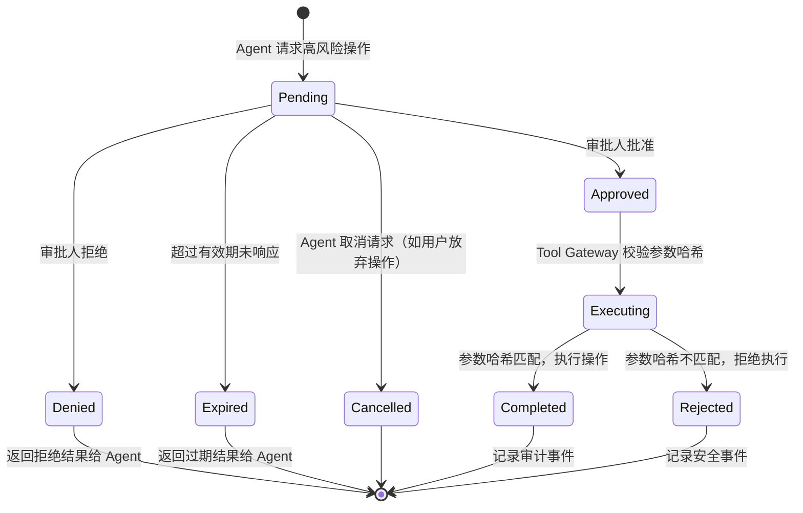
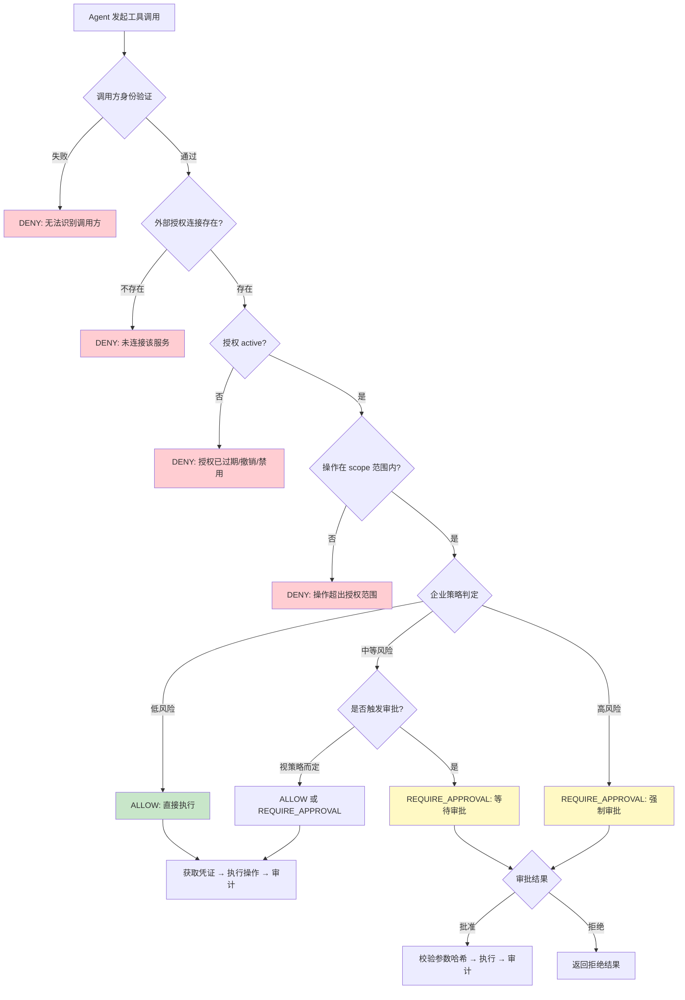

# 第 9 章：高风险操作的审批与策略引擎

## 本章目标

对具有明显业务影响的工具调用实施可解释、可追溯的控制。通过本章，读者将理解：

- 哪些操作需要审批：发送外部消息、修改工单、写入代码、删除资源
- **即使员工已授权 Agent 访问第三方服务，高风险操作仍需要额外审批**
- 静态策略、动态策略与 LLM-as-a-Judge 的差异
- Allow、Deny、Require Approval 三类决策
- 审批请求的数据结构与状态机
- 审批人、操作目标、参数与有效期的绑定
- 审批后参数被修改的风险
- 超时、重复执行、撤销和失败恢复
- LLM 判定作为补充，而不是唯一安全边界

## OAuth 授权不等于审批豁免

员工通过 OAuth 授权 Agent 访问 GitHub（第 7 章），**不代表** Agent 的所有 GitHub 操作都免于审批。

**示例**：

| 操作 | OAuth 授权 | 是否需要审批 | 原因 |
|------|-----------|-------------|------|
| 读取 Issue | ✓ 已授权 | 否 | 低风险读取操作 |
| 创建 Pull Request | ✓ 已授权 | 视策略而定 | 中等风险，可能影响代码库 |
| 删除仓库 | ✓ 已授权（如果 scope 包含） | **是** | 高风险，不可逆操作 |
| 修改分支保护规则 | ✓ 已授权（如果 scope 包含） | **是** | 影响整个团队的安全策略 |
| 从组织中移除成员 | ✓ 已授权（如果 scope 包含） | **是** | 影响团队结构和权限 |

**核心原则**：OAuth 授权解决的是"Agent 是否有资格代表员工调用该服务"，而审批解决的是"这个具体操作是否被允许执行"。两者是独立的决策。

## 本章产出

- 策略决策流程
- 审批状态机
- 高风险工具调用的端到端示例

## 五类系统的高风险操作审批案例

不同类型的企业工具，其"高风险操作"的定义和审批要求各不相同：

| 系统类型 | 高风险操作 | 审批人 | 审批关注点 |
|---------|-----------|--------|-----------|
| 文档系统 | 批量删除文档、修改文档权限为公开 | 文档所有者或部门管理员 | 影响范围、是否为误操作 |
| 财务系统 | 批准超过金额阈值的费用、修改报销状态 | 财务审批人（非提交人） | 金额、职责分离、预算 |
| ERP/采购 | 提交大额采购申请、修改已审批订单 | 采购经理或财务 | 预算、供应商合规、金额阈值 |
| 企业 IM | 向全员频道发送消息、删除频道 | 频道管理员或通讯负责人 | 影响范围、消息内容审查 |
| 日历/会议室 | 取消他人的会议室预订 | 行政管理员 | 冲突原因、是否需要替代方案 |

**关键设计**：审批必须绑定具体的操作、目标资源和参数，防止"批准了一个操作，实际执行了另一个"。

## 审批请求数据结构

```typescript
interface ApprovalRequest {
  id: string;                    // 审批请求唯一 ID
  correlationId: string;         // 关联到完整的 Agent 请求链路
  employeeId: string;            // 发起操作的员工
  agentId: string;               // 执行操作的 Agent
  tenantId: string;              // 租户

  // 操作详情——审批的核心内容
  toolName: string;              // 工具名，如 "github", "finance"
  action: string;                // 操作，如 "delete_repo", "approve_expense"
  resource: string;              // 目标资源，如 "org/repo"
  parameters: Record<string, unknown>;  // 操作参数
  parametersHash: string;        // 参数的哈希值，用于审批后校验

  // 审批流程
  approverId: string;            // 谁有权限审批
  approverRole: string;          // 审批人角色（如 "finance_manager"）
  status: "pending" | "approved" | "denied" | "expired" | "cancelled";
  reason?: string;               // 申请审批的原因（由 Agent 提供）
  expiresAt: string;             // 审批有效期

  // 审计
  createdAt: string;
  respondedAt?: string;
  respondedBy?: string;
}
```

**参数哈希（`parametersHash`）是关键安全机制**：审批人批准时，系统记录请求参数的哈希值。实际执行操作前，Tool Gateway 重新计算当前参数的哈希，与审批时的哈希对比。如果不一致，说明参数被篡改，拒绝执行。

## 审批状态机



**审批后参数被替换的风险**：

```
1. Agent 请求："删除测试仓库 test-repo"
2. 审批人批准了这个操作
3. 但在执行前，Agent（或被诱导后）将参数修改为："删除生产仓库 prod-repo"
4. Tool Gateway 校验参数哈希，发现不匹配 → 拒绝执行
```

这是审批流程必须绑定参数哈希的原因。审批的不是"允许某类操作"，而是"允许这次具体操作"。

## 策略决策流程

Tool Gateway 的策略引擎对每次工具调用做出三类决策之一：



**低风险操作**（如读取 Issue、搜索文档）：ALLOW，直接执行。

**中等风险操作**（如创建 PR、提交费用报告）：由策略决定。如果员工角色、金额、目标资源符合预设条件，ALLOW；否则 REQUIRE_APPROVAL。

**高风险操作**（如删除仓库、批准大额费用、向全员发消息）：强制 REQUIRE_APPROVAL，无例外。

## LLM-as-a-Judge 的定位

LLM-as-a-Judge 是指让大模型辅助判断某个操作是否安全、是否应该被批准。它可以作为策略引擎的**补充**，但**不能作为唯一的安全边界**。

**适合 LLM-as-a-Judge 的场景**：

- 评估消息内容是否适合发送到全员频道（语义判断）。
- 判断一个费用描述是否合理（需要理解上下文）。
- 分析代码变更的风险等级（需要理解代码语义）。

**不适合 LLM-as-a-Judge 的场景**：

- 验证员工是否有权限访问某个资源（这是确定性的授权检查）。
- 验证 Token 是否有效（这是技术性的凭证检查）。
- 验证审批人和提交人是否不同（这是职责分离规则）。

**原则**：LLM-as-a-Judge 的输出应该作为策略决策的一个输入信号，而不是唯一决策依据。最终的 ALLOW/DENY/REQUIRE_APPROVAL 必须由确定性的策略引擎做出。

## 审批的超时、重试与失败恢复

| 场景 | 处理 |
|------|------|
| 审批超时（如 30 分钟无响应） | 标记为 `expired`，通知 Agent 和申请人 |
| 审批人拒绝 | 标记为 `denied`，返回拒绝原因给 Agent |
| Agent 在审批期间取消 | 标记为 `cancelled` |
| 参数哈希不匹配 | 记录安全事件，拒绝执行，通知安全团队 |
| 审批通过后执行失败（如网络错误） | 不自动重试——可能改变业务状态。返回错误给 Agent，由其决定是否重新发起审批 |
| 审批通过后目标资源已被删除 | 返回资源不存在错误，不重试 |

## 实现步骤

审批流程的实现涉及 Control Plane、Tool Gateway 和 Web Console 的协作。完整的参考实现放在 `examples/09/`（待开发）。

关键设计要点：

1. **审批请求由 Tool Gateway 创建**，绑定操作详情和参数哈希。
2. **审批人由 Control Plane 根据组织关系确定**（如员工的直属经理、部门负责人）。
3. **审批在 Web Console 中完成**，审批人看到操作详情、参数和目标资源。
4. **执行前 Tool Gateway 重新校验参数哈希**，不一致则拒绝。
5. **审批结果和操作结果都记录到审计日志**。

## 安全边界、取舍与剩余风险

### 本章方案能防范什么

| 威胁 | 防范机制 | 有效性 |
|------|----------|--------|
| 高风险操作被直接执行 | 强制审批流程 | 强 |
| 审批后参数被替换 | 参数哈希校验 | 强 |
| 审批超时导致操作挂起 | 超时自动拒绝 | 强 |
| LLM-as-a-Judge 判断失误 | 不作为唯一边界 | 中 |

### 本章方案不能防范什么

| 威胁 | 需要补充的措施 |
|------|----------------|
| 审批人恶意批准 | 审计日志 + 事后审查 |
| 审批人账号被劫持 | 审批人自身的安全控制（MFA 等） |
| 策略配置错误 | 策略变更审批 + 灰度发布 |

## 本章小结

1. **OAuth 授权不等于审批豁免**：授权解决"能否调用"，审批解决"能否执行这个操作"。
2. **审批绑定具体操作、目标和参数**：通过参数哈希防止批准后替换操作内容。
3. **三类策略决策**：ALLOW（低风险）、DENY（未授权）、REQUIRE_APPROVAL（高风险）。
4. **五类系统各有不同的高风险定义**：财务看金额阈值，IM 看影响范围，ERP 看业务影响。
5. **LLM-as-a-Judge 是补充而非唯一边界**：语义判断用 LLM，确定性的授权和职责分离用策略引擎。
6. **审批有明确的超时和失败处理**：不自动重试可能改变业务状态的操作。

## 参考资料

- 策略引擎设计参考：Open Policy Agent (OPA) https://www.openpolicyagent.org/
- MCP 安全最佳实践：https://modelcontextprotocol.io/specification/draft/basic/authorization/security_best_practices
